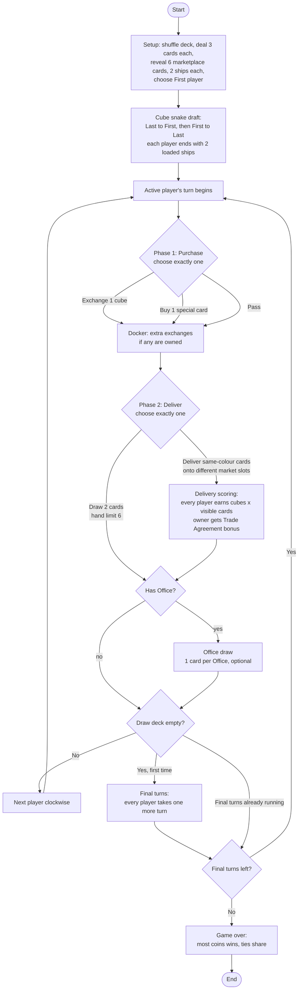

# Merchants – Product Requirements: Game Logic Package

| | |
|---|---|
| **Status** | Draft v1 – supersedes the earlier draft PRD |
| **Scope** | Game logic only (rules, state, errors, determinism, concurrency) |
| **Companion doc** | `Game-rules.md` (kept separate; this PRD references it and records every rule decision that file leaves open) |

---

## 1. Phase overview

### a. Purpose

Deliver a **UI-free, deterministic, offline Swift package** that fully implements the board game *Merchants* and is the single source of truth for the game rules. When this phase is done, a host (a future UI, a test, a bot) can create a game, submit actions, receive events, and reach a correct game-over state with winners. Nothing else is required.

Goals:

1. Correct rules, including the edge cases listed in §4.
2. Strict, opinionated structure: each concern has exactly one owner, and a thrown error tells you which part of the game refused.
3. Reproducible games: the same seed plus the same actions always produce the same state.
4. A clean seam for bots, added in a later phase.

### b. In-scope features

- Game configuration and setup (deck, hands, marketplace, ships, first player).
- Coins, banking and transactions.
- Goods cards, draw deck, player hands, cube supply, ships, marketplace.
- Special cards (Ship, Office, Docker, Trade Agreement).
- Cube snake draft (pre-game).
- Turn flow: Phase 1 (Purchase), Phase 2 (Deliver), end of turn.
- Delivery scoring, end-game trigger, final turns, winners.
- Game actions, events, rejections, layered typed errors.
- Pure rules engine plus a single `GameStore` actor.
- Hidden-information projection (`PlayerView`) for pass-and-play and future bots.
- **Placeholders only** for bots (protocol plus a dummy conformer).
- Unit, property/invariant and replay tests.

### c. Out-of-scope features (explicit prohibitions)

- **No UI**: no SwiftUI, UIKit, AppKit, Combine, or `@MainActor` anywhere in the package.
- **No persistence**: no save games, DTOs, DB entities, `UserDefaults`, files. (Domain types are `Codable` so a later phase *can* map them; this phase does not do it.)
- **No Game Center, online play, networking, analytics, or accounts.**
- **No message-log rendering or localised log text.** The package emits `GameEvent`s; turning them into sentences is a UI concern.
- **No user preferences or settings** (sound, theme, animation speed, etc.).
- **No bot intelligence.** Only the protocol and a trivial placeholder.
- **No timers, animation hooks, or delays.**
- **No observer pattern** (delegates, `NotificationCenter`, Combine, KVO). The one exception is `GameStore.updates()` (FR20).
- **No `Core`, `Utils`, `Services`, `Helpers`, `Managers`, `Components` folders or types.**
- Do not invent rules. Where the rules are ambiguous, follow §4 and flag it.

### Platform and toolchain

- Swift 6.x, complete strict concurrency, `Sendable` everywhere.
- iOS first. iPadOS, macOS and tvOS later, so the package must have no platform-specific imports. Foundation only.
- XCTest.

---

## 2. Architecture principles

1. **Domain-driven.** Each bounded concept is its own SwiftPM library target. A target may hold several feature folders when they share one context.
2. **Folders and types are named for what they do.** Reading the tree should tell you what the game does.
3. **Single owner per concern.**

   | Concern | Only owner that may mutate it |
   |---|---|
   | Coin arithmetic | `Coins` |
   | Money movement between players/bank | `Banking` (using `Coins`) |
   | Draw deck order and draws | `DrawDeck` |
   | Cards in a player's hand | `Hand` |
   | Cubes in the common supply | `CubeSupply` |
   | Cubes on ships, ship ownership of a cube | `Ships` |
   | The 6 demand slots | `Marketplace` |
   | Special-card stock and a player's special cards | `SpecialCards` |
   | Whose turn / which phase | `TurnFlow` |
   | End trigger and winners | `GameEnding` |

   The engine *orchestrates* these owners; it never reaches inside them.
4. **Domain models are not infrastructure models.** Save records, DTOs and DB entities (future) must never be the domain types, even if the fields look identical. DRY means not duplicating *knowledge*: a DTO changes when the storage format changes, a domain type changes when the rules change.
5. **Value types by default.** Models are `struct` / `enum`, `Codable`, `Equatable`, `Sendable`. The **only actor is `GameStore`**.
6. **Functional core.** Rules are pure functions: `(State, Action) throws -> (State, [Event])`. Mutation happens only inside a `mutating` method of the owning value type, on a private copy.
7. **Protocols at seams, not everywhere.** Protocols exist where something is genuinely swappable: `RandomSource`, `BotStrategy`. Do not create a protocol for a type with one implementation and no test double.
8. **Every Swift file starts with a summary header** (3–6 lines) saying what the file does, what it owns, and what it deliberately does *not* do.

   ```swift
   // Coins.swift
   // Pure coin arithmetic: add and subtract with validation.
   // Knows nothing about players, the bank, or why money moves.
   ```
9. **Determinism.** No `Date()`, no `UUID()`, no `SystemRandomNumberGenerator`, no `Dictionary`/`Set` iteration order dependence inside rules. All randomness comes from an injected `RandomSource` seeded at the boundary.
10. **No observers** unless needed (see out-of-scope).

---

## 3. Package structure

### 3.1 Decisions on the draft's open questions

| Draft question | Decision |
|---|---|
| Split game logic into a `Core` folder? | **No.** "Core" says nothing. The whole package *is* the game. Instead, name each target for what it does and enforce a one-directional dependency graph (§3.3). |
| Where do message logs, preferences, turn management go? | **Message log**: rendering is out of scope; the package only emits `GameEvent` (in `GameActions`), which a future log consumes. **Preferences**: out of scope, belong to the app. **Turn management**: *is* game logic, so it is a target called `TurnFlow`. |
| `Winner/` | Renamed **`GameEnding`**, because it owns both the end trigger and the winners. |
| `State/` | Kept as **`GameState`**, but it holds only the composed state plus `PlayerView` projections. It contains no rules. |
| `Bank/` | Renamed **`Banking`** to match its error type `BankingError`. |
| `Players/`, `Ships/`, `Goods/`, `Marketplace/` | Kept. `Goods` is reduced to the shared vocabulary type only; the deck, hand and cubes get their own owners. |

### 3.2 Targets and folders

```text
Merchants/
├─ Package.swift
├─ Sources/
│  ├─ Coins/                 // pure arithmetic: add, subtract, errors. Knows nothing else
│  │   ├─ Coins.swift
│  │   ├─ CoinAction.swift
│  │   └─ CoinError.swift
│  │
│  ├─ Banking/               // all in-game money movement
│  │   ├─ Bank.swift             // per-player balances, atomic apply
│  │   ├─ Transaction.swift      // what moved, to/from whom, and WHY
│  │   ├─ TransactionReason.swift
│  │   └─ BankingError.swift
│  │
│  ├─ Players/               // identity and seating
│  │   ├─ PlayerID.swift
│  │   ├─ PlayerCount.swift      // single place for the min/max player constants
│  │   ├─ Seating.swift          // clockwise order, next/previous
│  │   └─ PlayersError.swift
│  │
│  ├─ Goods/                 // shared vocabulary only
│  │   ├─ GoodType.swift         // the 6 goods
│  │   ├─ GoodsCard.swift
│  │   └─ GoodsCube.swift
│  │
│  ├─ DrawDeck/              // the face-down draw pile
│  │   ├─ DrawDeck.swift
│  │   ├─ DeckBuilder.swift      // 60 cards, shuffled via RandomSource
│  │   └─ DrawDeckError.swift
│  │
│  ├─ Hand/                  // one player's private cards
│  │   ├─ Hand.swift
│  │   ├─ HandLimit.swift
│  │   └─ HandError.swift
│  │
│  ├─ CubeSupply/            // the common pool (5 cubes per good)
│  │   ├─ CubeSupply.swift
│  │   └─ CubeSupplyError.swift
│  │
│  ├─ Ships/                 // ships and the one cube each may hold
│  │   ├─ Ship.swift
│  │   ├─ Fleet.swift            // one player's ships
│  │   └─ ShipError.swift
│  │
│  ├─ Marketplace/           // the 6 demand slots
│  │   ├─ Marketplace.swift
│  │   ├─ MarketSlot.swift
│  │   ├─ Demand.swift           // visible count per good
│  │   └─ MarketplaceError.swift
│  │
│  ├─ SpecialCards/          // Ship / Office / Docker / Trade Agreement
│  │   ├─ SpecialCardKind.swift  // kind, price, stock size
│  │   ├─ SpecialCardStock.swift // what is left to buy
│  │   ├─ Tableau.swift          // one player's special cards (counts)
│  │   ├─ SpecialCardEffects.swift // pure derived values: extra exchanges, office draws, trade bonus
│  │   └─ SpecialCardError.swift
│  │
│  ├─ DeliveryScoring/       // pure: delivery -> payouts
│  │   ├─ DeliveryScoring.swift
│  │   └─ DeliveryScoringError.swift
│  │
│  ├─ TurnFlow/              // whose turn, which phase, round/turn order
│  │   ├─ TurnPhase.swift
│  │   ├─ TurnFlow.swift
│  │   └─ TurnFlowError.swift
│  │
│  ├─ GameEnding/            // end trigger, final turns, winners
│  │   ├─ GameEnding.swift
│  │   ├─ Standings.swift
│  │   └─ GameEndingError.swift
│  │
│  ├─ GameActions/           // vocabulary of the engine boundary
│  │   ├─ GameAction.swift
│  │   ├─ GameEvent.swift        // what happened; feed to a message log later
│  │   ├─ EngineError.swift      // umbrella over every context error
│  │   └─ ActionRejection.swift  // who tried what, and who refused
│  │
│  ├─ GameState/             // composed state plus projections
│  │   ├─ GameState.swift
│  │   └─ PlayerView.swift       // what one player is allowed to see
│  │
│  ├─ GameSetup/             // configuration, initial deal, cube snake draft
│  │   ├─ GameConfiguration.swift
│  │   ├─ InitialDeal.swift
│  │   ├─ CubeDraft.swift
│  │   └─ GameSetupError.swift
│  │
│  ├─ GameEngine/            // the pure rules reducer
│  │   ├─ GameEngine.swift       // apply(action, to: state) throws(ActionRejection)
│  │   ├─ PurchasePhaseRules.swift
│  │   ├─ DeliverPhaseRules.swift
│  │   ├─ RandomSource.swift     // protocol
│  │   └─ SeededRandomSource.swift
│  │
│  ├─ GameStore/             // the one actor: serialises actions, streams updates
│  │   ├─ GameStore.swift
│  │   └─ GameUpdate.swift
│  │
│  └─ BotPlaceholders/       // later phase: protocol plus a dummy only
│      ├─ BotStrategy.swift
│      └─ PassiveBot.swift
│
└─ Tests/                    // one test target per source target, same folder layout
   ├─ CoinsTests/ ├─ BankingTests/ ├─ PlayersTests/ ├─ DrawDeckTests/
   ├─ HandTests/ ├─ CubeSupplyTests/ ├─ ShipsTests/ ├─ MarketplaceTests/
   ├─ SpecialCardsTests/ ├─ DeliveryScoringTests/ ├─ TurnFlowTests/
   ├─ GameEndingTests/ ├─ GameActionsTests/ ├─ GameSetupTests/
   ├─ GameEngineTests/ ├─ GameStoreTests/ └─ BotPlaceholdersTests/
```

> The target count is deliberately fine-grained to keep single ownership enforceable by the compiler (a target that does not import `Banking` cannot touch coins). If this feels heavy, `Goods`+`DrawDeck`+`Hand`+`CubeSupply` are the first candidates to merge into one `GoodsCards`/`GoodsCubes` pair. Merge only if the ownership table in §2.3 still holds.

### 3.3 Dependency rules (one direction only, no cycles)

```text
Layer 0  Coins   Players   Goods
Layer 1  Banking(→Coins, Players)   DrawDeck(→Goods)   Hand(→Goods)   CubeSupply(→Goods)
         Ships(→Goods)   Marketplace(→Goods)   SpecialCards(→Players)
Layer 2  DeliveryScoring(→Marketplace, Ships, SpecialCards, Banking, Players)
         TurnFlow(→Players)   GameEnding(→Banking, Players)
Layer 3  GameActions(→ all Layer 0–2 error types and vocabulary)
         GameState(→ all Layer 0–2 owners)
Layer 4  GameSetup(→ GameState)   GameEngine(→ GameState, GameActions, GameSetup)
Layer 5  GameStore(→ GameEngine)   BotPlaceholders(→ GameState, GameActions)
```

Rules: a lower layer never imports a higher layer. Layer 1 owners never import each other. `Coins` imports nothing but Foundation.

---

## 4. Game rules: clarifications and assumptions

I reviewed `Game-rules.md` and found conflicts, gaps and ambiguities. Each has a **proposed default** so the engine can be built, and a status. Items marked **OPEN** need your decision; changing one later should touch one place.

| ID | Topic | What the rules say / the problem | Proposed default | Status |
|---|---|---|---|---|
| Q1 | **Player count** | PRD draft says 3–5; rules say 2–4. Components (14 ships) allow up to 7. | `PlayerCount` holds the range in **one constant**; default **2…4** (per rules) until confirmed. | OPEN |
| Q2 | **Starting coins** | Not stated anywhere. | **0**, configurable via `GameConfiguration.startingCoins`. Coin supply is unlimited. | OPEN |
| Q3 | **When the game ends** | Rules file: ends right after the turn in which the deck empties. Your brief: *everyone* gets one more turn. | **All players, including the one who emptied the deck, take exactly one final turn**, then scoring (N extra turns). The alternative, "finish the round up to the player before First", gives unequal turn counts and is rejected. | OPEN |
| Q4 | **Phase 2 with an empty deck** | During final turns the deck is empty, so *Draw 2* is impossible. | Only *Deliver* is legal. If the player also has no legal Deliver (empty hand), Phase 2 is **auto-skipped** with a `phase2Skipped` event. | OPEN |
| Q5 | **Hand limit (6)** | Not stated what happens if *Draw 2* or an Office draw would exceed 6. | *Draw 2* draws `min(2, 6 − handCount)` and is **rejected if the hand is already 6**. Office draw is capped the same way. No discards. | OPEN |
| Q6 | **Office** | "may draw" (optional?) and per-office count (original rules: one per office). | **One card per Office owned, optional** (player may decline), capped by hand limit and deck size. | OPEN |
| Q7 | **Docker** | "Exchange an extra cube in Phase 1, regardless of the action chosen." Unclear: extra *per* Docker? Can the extra exchange happen without a base Exchange (e.g. after Buy or Pass)? Can the same ship be exchanged twice? | Allowed Phase-1 exchanges = `(base action is Exchange ? 1 : 0) + dockerCount`. Extra exchanges are usable after *any* base action (including Pass), and **immediately after buying a Docker**. The same ship may be exchanged more than once. | OPEN |
| Q8 | **Trade Agreement** | Rules file: bonus when the **owner** delivers. Original game: bonus whenever the owner **earns coins on anyone's** delivery. | **Rules-file version**: `2 × agreements` to the delivering owner on *their own* delivery, paid even if their cubes earned 0. | OPEN |
| Q9 | **Same-colour cover** | May a card be played onto a slot already showing the same colour? | **Allowed.** The only constraint is one card per distinct slot per delivery. | OPEN |
| Q10 | **Minimum delivery** | "Any number of cards." | **1…6 cards**, all the same colour, each on a different slot. Zero cards is not a delivery. | |
| Q11 | **Buying a Ship** | "Must load it with an available cube; if none exists, can't buy." | The Buy action carries the chosen cube colour. Rejected if the Ship stock is empty, the cube supply is empty, or the chosen colour has no cubes left. Coins are only charged when the load is also valid (atomic). | |
| Q12 | **Special card limits** | 2 Offices, 2 Dockers, 2 Trade Agreements exist in total (shared by all players). 14 Ships minus 2 per player remain. | Stock tracked in `SpecialCardStock`. Buying a depleted kind is rejected. | |
| Q13 | **Discarded cards** | Covered marketplace cards leave the game. | Covered cards are **removed from play** (not reshuffled). The deck never refills. | |
| Q14 | **Snake draft pick colour** | Can a player draft two cubes of the same colour? | **Yes** (5 per colour exist). The draft is public, ships start empty and each pick targets a specific empty ship. | |
| Q15 | **Stray "workers"** | Setup step 5 mentions *workers* but nothing uses them. | **Ignored.** Not modelled. | |
| Q16 | **Rules typo** | The scoring example mentions a *Yellow* good; the six goods are white, blue, red, green, purple, brown. | Treat as a typo; tests use the six real goods. | |
| Q17 | **Illegal-state wording** | "Pass" in Phase 1 is "do nothing". | `pass` is an explicit action. Phase 2 can never be passed. | |
| Q18 | **Tie** | All tied players win. | `GameEnding` returns `[PlayerID]` sorted by seat order. | |

### 4.1 Rules summary (as implemented)

- **Setup:** shuffle 60 goods cards (10 per good) → deal 3 per player → reveal 6 into the marketplace → give each player 2 ships → pick first player (random or configured) → cube snake draft.
- **Snake draft:** starting with the *last* player going counter-clockwise to the First player, each picks one cube from the supply onto an empty ship; then reversing, from the First player clockwise to the last, each picks a second. Every player ends with exactly two loaded ships.
- **Turn:** Phase 1 (Purchase: *exactly one* of Exchange one cube / Buy one special card / Pass) → Phase 2 (Deliver: *exactly one* of Deliver cards / Draw 2) → Office draw (if owned) → end of turn → check end condition → next player clockwise. The First player never changes.
- **Delivery scoring:** after cards are placed, **every** player earns `cubesOnShips(good) × visibleCards(good)` for the delivered good. Trade Agreement bonus per Q8.
- **Special cards** give no victory points.
- **Winner:** most coins; ties share the win.

---

## 5. Game flow

### 5.1 Overview (text)

```text
SETUP
  shuffle deck -> deal 3 cards each -> reveal 6 market cards -> 2 ships each -> choose First player
  -> CUBE SNAKE DRAFT:  Last -> ... -> First   then   First -> ... -> Last   (each player ends with 2 cubes)

GAME LOOP (clockwise from First, First never changes)
  Turn:   Player A -> Player B -> Player C -> Player A -> ...
  On a player's turn:   Phase 1 (Purchase)  ->  Phase 2 (Deliver)  ->  Office draw?  ->  End of turn
  After End of turn:    deck empty?  no -> next player
                                     yes -> FINAL TURNS: every player takes one more turn

GAME OVER
  final scoring: most coins wins, ties share the win
```

### 5.2 Diagram



### 5.3 Engine state machine

```text
GamePhase
  .cubeDraft(step)                // snake draft picks
  .purchase(player, usedBaseAction, extraExchangesLeft)
  .deliver(player)
  .officeDraw(player, cardsLeft)  // only if the player owns Offices
  .finished(winners)

GameEnding tracks:  deckEmptiedOnTurn, finalTurnsRemaining
```

---

## 6. Error handling requirements

**Goal:** when something throws, the *type alone* tells you which part of the game threw it.

1. **One error type per target**, named for its context: `CoinError`, `BankingError`, `PlayersError`, `DrawDeckError`, `HandError`, `CubeSupplyError`, `ShipError`, `MarketplaceError`, `SpecialCardError`, `DeliveryScoringError`, `TurnFlowError`, `GameEndingError`, `GameSetupError`. Numeric/unit problems (`CoinError`) are never mixed with flow problems (`TurnFlowError`).
2. **`EngineError`** is the single umbrella at the public boundary, wrapping each context error:

   ```swift
   public enum EngineError: Error, Equatable, Sendable {
       case coins(CoinError)
       case banking(BankingError)
       case drawDeck(DrawDeckError)
       case hand(HandError)
       case cubeSupply(CubeSupplyError)
       case ships(ShipError)
       case marketplace(MarketplaceError)
       case specialCards(SpecialCardError)
       case deliveryScoring(DeliveryScoringError)
       case turnFlow(TurnFlowError)
       case gameEnding(GameEndingError)
       case setup(GameSetupError)
   }
   ```
   (The earlier draft used both `MerchantsError` and `EngineError`; the name is now `EngineError` only.)
3. **Rejected actions carry context.** `GameEngine.apply` throws `ActionRejection { error: EngineError, action: GameAction, player: PlayerID }`, so a log line can say *who tried what and which part refused*.
4. **Typed throws (Swift 6).** Public engine functions declare `throws(ActionRejection)`. Internal functions throw only their own context error.
5. **Atomic actions.** A rejected action never changes state. The engine works on a private copy and commits only on success. Tests assert `stateAfterRejection == stateBefore`.
6. **Every error case has at least one test** asserting the exact type *and* case, never just "throws".
7. **Errors are `Equatable`, `Sendable` and `CustomStringConvertible`.** Descriptions use `String(localized:bundle: .module)`; the package ships a `Localizable.xcstrings` per target that has errors. (`NSLocalizedString` / `String(localized:)` without `bundle: .module` would look in the wrong bundle inside a package.)

---

## 7. Feature requirements

Each feature lists: **Owner** (target), **Expectations** (behaviour), **Errors**, **Tests**.

### FR1-game-configuration

- **Owner:** `GameSetup`
- `GameConfiguration` (`Codable`, `Sendable`): `playerIDs` (ordered, defines seating), `seed: UInt64`, `firstPlayer: .random | .fixed(PlayerID)`, `startingCoins`.
- A convenience factory generates a seed from `SystemRandomNumberGenerator` **at the boundary only**, so the seed is stored in the state and replay works.
- Validates player count against `PlayerCount` (Q1), unique IDs, `startingCoins >= 0`.
- **Errors:** `GameSetupError.invalidPlayerCount`, `.duplicatePlayerID`, `.unknownFirstPlayer`, `.negativeStartingCoins`.
- **Tests:** each error, plus min/max boundary of player count.

### FR2-deterministic-randomness

- **Owner:** `GameEngine` (`RandomSource`, `SeededRandomSource`)
- `protocol RandomSource: Sendable { mutating func next() -> UInt64 }`. The only implementation is a seeded generator (e.g. SplitMix64).
- Shuffling uses **our own Fisher–Yates** over `RandomSource`. Do **not** rely on `shuffled(using:)`, whose output is not guaranteed stable across Swift releases and would break replays.
- Random state is part of `GameState` so a game can be resumed deterministically.
- Randomness is consumed in exactly two places: deck shuffle and (optionally) first-player choice.
- **Tests:** same seed ⇒ identical deck and first player; different seeds ⇒ different decks; generator golden-value test (fixed seed → fixed first N values).

### FR3-coins

- **Owner:** `Coins`. Imports Foundation only. Knows nothing about players, banks or reasons.
- `Coins` (`Equatable`, `Hashable`, `Codable`, `Sendable`) with `public private(set) var available: Int`, mutated only by `perform(_:)`.
- `CoinAction`: `.add(Int)`, `.subtract(Int)`. No default `= 0` arguments.
- **Throws instead of silently ignoring** (the draft's `add`/`subtract` returned silently on bad input even though `CoinError` exists):
  - negative amount → `CoinError.isNegativeNumber`
  - subtract more than available → `CoinError.insufficientFunds(required:available:)`
  - add would overflow `Int` → `CoinError.overflow`
- Zero is a valid no-op for both actions.
- `Codable` decode validates the value (`available >= 0`) so a corrupt payload cannot create invalid coins.
- Reference shape:

  ```swift
  public enum CoinError: Error, Equatable, Sendable {
      case isNegativeNumber
      case insufficientFunds(required: Int, available: Int)
      case overflow
  }

  public enum CoinAction: Equatable, Sendable {
      case add(Int)
      case subtract(Int)
  }

  public struct Coins: Equatable, Hashable, Sendable {
      public private(set) var available: Int
      public init(_ amount: Int = 0) throws(CoinError) { /* validates >= 0 */ }

      public mutating func perform(_ action: CoinAction) throws(CoinError) {
          switch action {
          case .add(let amount):
              guard amount >= 0 else { throw .isNegativeNumber }
              let (sum, overflowed) = available.addingReportingOverflow(amount)
              guard !overflowed else { throw .overflow }
              available = sum
          case .subtract(let amount):
              guard amount >= 0 else { throw .isNegativeNumber }
              guard available >= amount else {
                  throw .insufficientFunds(required: amount, available: available)
              }
              available -= amount
          }
      }
  }
  ```
- A failed `perform` leaves `available` unchanged.
- **Tests:** add/subtract happy paths; zero; exact-balance subtract (boundary); subtract by balance+1; negative on both; overflow at `Int.max`; Codable round-trip; Codable rejects negative.

### FR4-banking

- **Owner:** `Banking`. The only place coins move between players. Uses `Coins` for arithmetic; knows no card, ship or marketplace rule.
- `Bank` holds `[PlayerID: Coins]` for all players. (The common supply is unlimited, so "the bank" is the source/sink.)
- `Transaction`: `{ player, amount, direction (.credit/.debit), reason }`.
- `TransactionReason` (why money moved): `.deliveryPayout(good)`, `.tradeAgreementBonus`, `.specialCardPurchase(kind)`, `.startingFunds`.
- `Bank.apply(_ transactions: [Transaction]) throws(BankingError)` is **atomic for the whole batch**: validate on a copy, commit only if all succeed. One delivery produces one batch for all players.
- `Bank.balance(of:)`, `Bank.standings` (read-only).
- **Errors:** `BankingError.unknownPlayer(PlayerID)`, `.coin(CoinError)` (wraps the underlying coin failure with the player ID in the case payload).
- No other target may construct or mutate `Coins` for a player.
- **Tests:** single credit/debit; batch where the last debit fails ⇒ no balances change; unknown player; reasons preserved in the returned transaction list.

### FR5-goods-and-cards-vocabulary

- **Owner:** `Goods`
- `GoodType` enum with 6 cases: sugar (white), indigo (blue), spices (red), tea (green), silk (purple), lumber (brown). `CaseIterable`, `Codable`, `Sendable`, `Comparable` (declaration order, for deterministic output).
- `GoodsCard(good)` and `GoodsCube(good)` are plain values. Colour is **not** a concern of this package (the UI maps `GoodType` to a colour).
- **Tests:** exactly 6 cases; stable ordering.

### FR6-draw-deck

- **Owner:** `DrawDeck`
- `DeckBuilder.standardDeck(using:)` builds 60 cards (10 per good) and shuffles with `RandomSource` (FR2).
- `DrawDeck.draw(_ count:)` returns up to `count` cards from the top; `remaining`, `isEmpty`.
- Drawing more cards than remain returns the remainder (no error); drawing from an empty deck throws.
- The deck never refills or reshuffles.
- **Errors:** `DrawDeckError.empty`, `.invalidCount` (negative).
- **Tests:** composition 10 × 6; drawing 0; drawing exactly remaining; drawing more than remaining returns the remainder; draw on empty throws.

### FR7-hand

- **Owner:** `Hand`. The only place cards enter or leave a player's hand.
- `Hand` stores `[GoodsCard]`; `count`, `count(of:)`.
- `HandLimit.maximum = 6` (single constant).
- `add(_:)` rejects exceeding the limit; `remove(good:count:)` rejects removing cards not held.
- Hands are private information (see FR19).
- **Errors:** `HandError.limitExceeded(limit:attempted:)`, `.insufficientCards(good:required:available:)`.
- **Tests:** add up to exactly 6 (boundary), add the 7th; remove all of a colour; remove more than held.

### FR8-cube-supply

- **Owner:** `CubeSupply`
- Common pool: 5 cubes per good (30 total). `available(of:)`, `take(_:)`, `returnCube(_:)`.
- Invariant: for each good, `supply + onShips == 5`. Returning a cube that would push the supply above 5 is an error (guards bookkeeping bugs).
- **Errors:** `CubeSupplyError.noneAvailable(GoodType)`, `.supplyFull(GoodType)`.
- **Tests:** take all 5, take a 6th; return when full.

### FR9-ships

- **Owner:** `Ships`. The only place cubes are placed on or removed from ships.
- `Ship` holds `cube: GoodsCube?` (**max 1 cube**). `Fleet` is one player's ordered ships (starts with 2; grows via purchase).
- Operations: `load(_:onto:)` (empty ship only), `exchange(shipIndex:for:)` (returns the removed cube so the engine can return it to `CubeSupply`), `addShip()`, `cubeCount(of:)`.
- Exchange must produce a **different** colour from the one currently loaded.
- **Errors:** `ShipError.shipNotFound`, `.shipAlreadyLoaded`, `.shipEmpty`, `.sameGood`.
- **Tests:** load into empty/full ship; exchange to different/same colour; counts per colour across several ships.

### FR10-marketplace

- **Owner:** `Marketplace`
- Exactly 6 slots, each holding a stack whose **top** card is visible; covered cards are discarded from play (Q13).
- `Marketplace.deliver(_ placements: [(slot, GoodsCard)])`: all cards the same good, each to a **different** slot, slot in `0…5`, 1…6 cards (Q10). Same-colour cover is allowed (Q9).
- `demand(for:)` returns the count of visible cards of a good.
- `deliver` is atomic: invalid input changes nothing.
- **Errors:** `MarketplaceError.emptyDelivery`, `.mixedGoods`, `.duplicateSlot`, `.slotOutOfRange`, `.tooManyCards`.
- **Tests:** the example from the rules (with real colours); delivering to all 6 slots (boundary); 7 cards; duplicate slot; mixed colours.

### FR11-special-cards

- **Owner:** `SpecialCards`
- `SpecialCardKind`: `.ship` (10), `.office` (8), `.docker` (12), `.tradeAgreement` (11). Price lives only here.
- `SpecialCardStock`: Ships `14 − 2 × players`, Offices 2, Dockers 2, Trade Agreements 2.
- `Tableau`: per-player counts of owned special cards. Effects are **cumulative**.
- `SpecialCardEffects` (pure, derived from a `Tableau`): `extraExchanges`, `officeDraws`, `tradeAgreementBonus` (= 2 × count).
- Special cards are worth nothing at game end.
- **Errors:** `SpecialCardError.outOfStock(kind)`.
- **Tests:** price table; stock exhaustion per kind; cumulative effects (2 Offices ⇒ 2 draws; 2 Trade Agreements ⇒ 4 bonus).

### FR12-turn-flow

- **Owner:** `TurnFlow`
- Models phase transitions only: `purchase → deliver → officeDraw (if any) → endOfTurn → next player`.
- Order is clockwise from the First player; **the First player never changes**.
- Rejects any action that is not legal in the current phase and for the current player.
- **Errors:** `TurnFlowError.notYourTurn`, `.wrongPhase(expected:actual:)`, `.phaseAlreadyCompleted`, `.gameNotStarted`, `.gameFinished`.
- **Tests:** full turn sequence across 3 players and wrap-around; every wrong-phase and wrong-player rejection.

### FR13-cube-snake-draft

- **Owner:** `GameSetup` (`CubeDraft`)
- Pick order: Last → … → First (counter-clockwise), then First → … → Last (clockwise). Total picks = 2 × players.
- Each pick specifies a good and a specific empty ship; it takes a cube from `CubeSupply` and loads it via `Ships`.
- When the last pick is made the game moves to turn 1 with the First player.
- **Errors:** `GameSetupError.notDraftingPlayer`, `.shipNotEmpty`, `.draftComplete`.
- **Tests:** pick order for 2, 3, 4 players; same colour twice allowed (Q14); cannot pick out of turn; ends with every player holding exactly 2 cubes.

### FR14-purchase-phase

- **Owner:** `GameEngine/PurchasePhaseRules` (orchestrates `Ships`, `CubeSupply`, `SpecialCards`, `Banking`)
- Exactly one base action: `exchange`, `buy`, or `pass`.
- **Exchange:** cube from one of the player's ships is returned to the supply and replaced by a *different* colour taken from the supply.
- **Buy:** deduct the price via `Banking` and add to the `Tableau`; **buying a Ship** also requires choosing a cube to load (Q11); Docker effect is immediately available (Q7).
- **Docker extra exchanges:** per Q7.
- The phase ends when the player has used the base action and either has no extra exchanges left or explicitly ends the phase.
- Atomic: a purchase that fails validation charges nothing.
- **Errors (wrapped as `EngineError`):** `BankingError.coin(.insufficientFunds)`, `SpecialCardError.outOfStock`, `CubeSupplyError.noneAvailable`, `ShipError.sameGood`, `TurnFlowError.phaseAlreadyCompleted`.
- **Tests:** each base action; exact-price boundary and one coin short for each of the four cards; buying a Ship when the cube supply is empty (rejected, no charge); Docker bought then used immediately; two Dockers ⇒ up to 2 extras; exchanging when the wanted colour is exhausted.

### FR15-deliver-phase

- **Owner:** `GameEngine/DeliverPhaseRules`
- Exactly one of: **Deliver** (same-colour cards onto different slots) or **Draw 2**.
- **Draw 2:** from the deck, capped by hand limit (Q5), never triggers scoring and never pays Trade Agreements.
- Deck-empty and hand-empty handling per Q4.
- **Office draw** after Phase 2 per Q6, in the `officeDraw` step.
- **Errors:** `HandError.insufficientCards`, `.limitExceeded`, `MarketplaceError.*`, `DrawDeckError.empty`.
- **Tests:** Deliver 1 card, Deliver 6 cards (boundary), draw with hand at 4, 5 and 6; Draw 2 with 1 card left in the deck (draws 1, deck empty); office draw capped by hand limit.

### FR16-delivery-scoring

- **Owner:** `DeliveryScoring`. Pure function, no mutation.
- Input: delivered good, marketplace **after** placement, all fleets, the deliverer's `Tableau`. Output: `[Transaction]`.
- Payout per player = `cubes(of good on their ships) × demand(good)`. Players with 0 matching cubes get no transaction.
- Trade Agreement bonus to the deliverer per Q8, as a separate transaction with reason `.tradeAgreementBonus`.
- **Tests:** the rules' example (3 blue visible, cubes on several players); a player with several cubes of the colour; deliverer with 0 matching cubes but a Trade Agreement; 2 Trade Agreements ⇒ 4; non-delivering Trade Agreement owner gets nothing (Q8).

### FR17-end-game-and-winners

- **Owner:** `GameEnding`
- Trigger: the draw deck reaches 0 (from a Draw 2 *or* an Office draw). Checked **at the end of the active player's turn**, not mid-turn.
- Final turns per Q3: exactly one more full turn per player, in the normal clockwise order, then the game is `.finished`.
- Winners = all players with the maximum coins (Q18). `Standings` lists balances in seat order.
- The trigger fires once; later empty-deck states do not extend the game.
- **Errors:** `GameEndingError.gameNotOver`, `.alreadyEnded`.
- **Tests:** deck empties via Draw 2; via Office draw; deck empties on the last player's turn (wrap-around); deck empties on the First player's turn; single winner; 2-way and N-way ties; winner calculation ignores special cards.

### FR18-game-actions-and-events

- **Owner:** `GameActions`
- `GameAction` (`Codable`, `Equatable`, `Sendable`), including at least:
  `draftCube`, `exchangeCube`, `buySpecialCard`, `passPurchase`, `endPurchase`, `deliverCards`, `drawCards`, `officeDraw`, `declineOfficeDraw`.
- `GameEvent` describes **what happened**, with enough data to render a log without querying state: `cubeDrafted`, `cubeExchanged`, `specialCardBought`, `cardsDelivered`, `coinsEarned(player, amount, reason)`, `cardsDrawn(player, count)` (count only, **never** the card identities for other players), `officeDrawn`, `phase2Skipped`, `turnEnded`, `deckEmptied`, `finalTurnsBegan`, `gameEnded(winners)`.
- Every successful action returns ≥ 1 event.
- No strings or localisation in events.
- **Tests:** each action yields the expected event list; events are `Codable` round-trippable.

### FR19-game-engine-and-player-view

- **Owner:** `GameEngine`, `GameState`
- `GameEngine.apply(_ action: GameAction, by player: PlayerID, to state: GameState) throws(ActionRejection) -> (GameState, [GameEvent])` is a **pure function**.
- Pipeline: validate turn/phase (`TurnFlow`) → run the phase rules → commit all owner mutations on a copy → advance flow/end check (`GameEnding`) → return.
- `GameState` composes the owners' values (`Bank`, `DrawDeck`, `[PlayerID: Hand]`, `CubeSupply`, `[PlayerID: Fleet]`, `Marketplace`, `SpecialCardStock`, `[PlayerID: Tableau]`, `TurnFlow`, `GameEnding`, random state). It contains **no rules**.
- `PlayerView` is a read-only projection for one player: own hand in full, others' hand **sizes** only, deck count (not order), everything else public. Bots and pass-and-play handoff use it.
- `GameState.legalActions(for:)` is derived from the same rule functions the engine uses, never a second copy of the rules.
- **Tests:** engine purity (same input ⇒ same output); `PlayerView` never leaks other hands or deck order; `legalActions` all succeed and rejected actions are not in the list.

### FR20-game-store

- **Owner:** `GameStore`. The **only actor** in the package.
- `actor GameStore` holds the current `GameState`, serialises `send(_ action:by:)` calls, and calls the pure engine.
- `func updates() -> AsyncStream<GameUpdate>`. `GameUpdate` = `{ newState, events }` (and the rejection for failed attempts, if a consumer wants it). This is the **only** observation mechanism, and nothing else in the package observes.
- Rejected actions are thrown to the caller and **not** published as state changes.
- Streams finish when the game ends.
- No `@MainActor`, no Combine.
- **Tests:** two concurrent submissions are serialised; subscriber receives updates in order; rejected action leaves state and stream unchanged; stream finishes at game over.

### FR21-bot-placeholders

- **Owner:** `BotPlaceholders`
- `protocol BotStrategy: Sendable { func chooseAction(for view: PlayerView, legalActions: [GameAction]) -> GameAction }`
- `PassiveBot`: deterministic dummy that picks the first legal action. It exists so the seam is tested and so FR23's strategy test has something to drive.
- **No** heuristics, search, learning or difficulty levels this phase.
- **Tests:** `PassiveBot` always returns a member of `legalActions`.

### FR22-error-layering

- **Owner:** `GameActions` (`EngineError`, `ActionRejection`)
- Implements §6. Every context error converts into exactly one `EngineError` case through a single mapping point.
- `ActionRejection` carries `EngineError`, the `GameAction` and the acting `PlayerID`, and is `CustomStringConvertible` for log lines.
- **Tests:** one test per context-error → `EngineError` mapping; atomicity assertion in every rejection test.

### FR23-testing-and-replay

- **Owner:** all test targets
- One XCTest target per source target, mirroring the folder layout.
- Every rule: a happy path, each rejection, and a boundary.
- **Seeded random-play test:** play many seeded games using random legal actions; after **every** action assert the invariants below.
- **Strategy test:** `PassiveBot` and a "deliver-whenever-possible" bot both reach `.finished` within a bounded number of turns (no infinite loops).
- **Replay test:** (seed + ordered action list) ⇒ identical final `GameState` and identical event list.
- **Invariants after every action:**
  1. For each good: `supply + shipsLoaded == 5`.
  2. Every ship holds 0 or 1 cube.
  3. Cards conserved: `deck + hands + marketplace(all stacks) == 60`.
  4. No hand > 6.
  5. No negative balances.
  6. Total coins change only by delivery payouts and special-card purchases (money in/out matches transactions).
  7. Special card stock + owned == initial stock.
  8. Marketplace has exactly 6 visible cards.
  9. Exactly one active player until `.finished`; First player unchanged.

---

## 8. Concurrency

- Rules and models are value types. Each action runs on a **private copy** (transaction semantics); the copy is committed only on success.
- The live game is one `GameStore` actor. It serialises actions and broadcasts `GameUpdate` through `AsyncStream`.
- `Bank`, `Hand`, `Fleet` and friends are **not** actors. Validate-then-charge-then-apply must stay one atomic step.
- All public types are `Sendable`. No `@unchecked Sendable` without a documented reason.

## 9. Definition of done

1. All FRs implemented; Swift 6 strict concurrency builds with zero warnings.
2. No import of UIKit/SwiftUI/Combine; no `@MainActor`; no persistence; no forbidden folder names.
3. Every error case has an exact-case test; every rejection has an atomicity assertion.
4. Seeded random-play, strategy and replay tests pass.
5. Every file has its summary header.
6. All **OPEN** items in §4 are resolved or consciously accepted.
