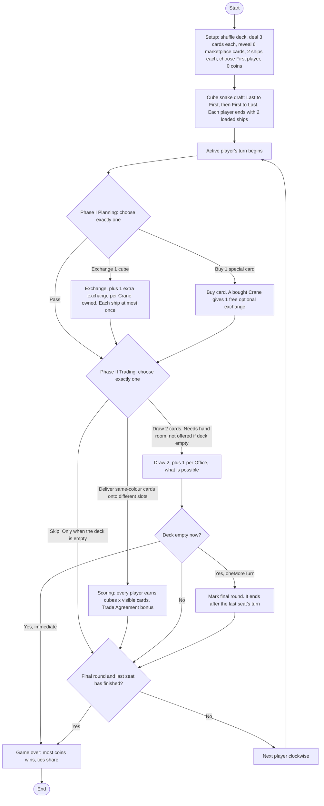

# Merchants – Product Requirements: Game Logic Package

| | |
|---|---|
| **Status** | Draft v3 – supersedes all earlier drafts; incorporates the EC-1 to EC-37 decisions |
| **Scope** | Game logic only (rules, state, errors, determinism, concurrency) |
| **Companion doc** | `Game-rules.md` (kept separate). Every deviation from the original game is listed in Appendix A |

> **Convention:** every edge case, ambiguity or rule decision has an ID of the form **EC-<int>** (register in §4.3). Use these IDs in code comments, tests (`test_EC14_...`) and conversation.

---

## 1. Phase overview

### a. Purpose

Deliver a **UI-free, deterministic, offline Swift package** that fully implements the board game *Merchants* (with the house rules in Appendix A) and is the single source of truth for the game rules. When this phase is done, a host (a future UI, a test, a bot) can create a game, submit actions, receive events, and reach a correct game-over state with winners.

Goals:

1. Correct rules, including every edge case in §4.3.
2. Strict, opinionated structure: each concern has exactly one owner, and a thrown error tells you which part of the game refused.
3. Reproducible games: the same seed plus the same actions always produce the same state.
4. A clean seam for bots, added in a later phase.

### b. In-scope features

- Game configuration, tunable `GameRules`, and setup (deck, hands, marketplace, ships, first player).
- Coins, banking and transactions.
- Goods cards, draw deck, player hands, warehouse, cube supply, ships (standard and large), marketplace.
- Special cards: Ship, Large Ship, Office, Crane, Trade Agreement, Customs House, Warehouse.
- Cube snake draft (pre-game).
- Turn flow: Phase I (Planning), Phase II (Trading), automatic Office draws, end of turn.
- Delivery scoring, end-game rule (`immediate` or `oneMoreTurn`), winners.
- Game actions, events, rejections, layered typed errors.
- Pure rules engine plus a single `GameStore` actor.
- Hidden-information projection (`PlayerView`).
- Validating restore: every type is `Codable` and decoding never yields an invalid state.
- **Placeholders only** for bots (protocol plus a dummy conformer).
- Unit, property/invariant and replay tests.

### c. Out-of-scope features (explicit prohibitions)

- **No UI**: no SwiftUI, UIKit, AppKit, Combine, or `@MainActor` anywhere in the package.
- **No persistence**: no save games, DTOs, DB entities, `UserDefaults`, files. (Domain types are `Codable` so a later phase *can* map them.)
- **No Game Center, online play, networking, analytics, or accounts.**
- **No message-log rendering or localised log text.** The package emits `GameEvent`s only.
- **No user preferences or settings.**
- **No bot intelligence.** Only the protocol and a trivial placeholder.
- **No timers, animation hooks, or delays.**
- **No additional special cards** beyond the seven in §4.2. Explicitly rejected: Customs-House-style catch-up cards, Shipyard, Guild Charter, Lookout.
- **No observer pattern** (delegates, `NotificationCenter`, Combine, KVO). The one exception is `GameStore.updates()` (FR20).
- **No `Core`, `Utils`, `Services`, `Helpers`, `Managers`, `Components` folders or types.**
- Do not invent rules. Where the rules are ambiguous, follow §4 and flag it as a new EC entry.

### Platform and toolchain

- Swift 6.x, complete strict concurrency, `Sendable` everywhere.
- iOS first. iPadOS, macOS and tvOS later, so no platform-specific imports. Foundation only.
- XCTest.

---

## 2. Architecture principles

1. **Domain-driven.** Each bounded concept is its own SwiftPM library target. A target may hold several feature folders when they share one context.
2. **Folders and types are named for what they do.**
3. **Single owner per concern.**

   | Concern | Only owner that may mutate it |
   |---|---|
   | Coin arithmetic | `Coins` |
   | Money movement between players/bank | `Banking` (using `Coins`) |
   | Draw deck order and draws | `DrawDeck` |
   | Cards in a player's hand and warehouse | `Hand` |
   | Cubes in the common supply | `CubeSupply` |
   | Cubes on ships, ship ownership of a cube | `Ships` |
   | The 6 demand slots | `Marketplace` |
   | Special-card stock, prices, a player's special cards | `SpecialCards` |
   | Whose turn / which phase / Planning progress | `TurnFlow` |
   | End trigger and winners | `GameEnding` |

   The engine *orchestrates* these owners; it never reaches inside them.
4. **Domain models are not infrastructure models.** Save records, DTOs and DB entities (future) must never be the domain types. DRY means not duplicating *knowledge*.
5. **Value types by default.** Models are `struct` / `enum`, `Codable`, `Equatable`, `Sendable`. The **only actor is `GameStore`**.
6. **Functional core.** Rules are pure functions: `(State, Action) throws -> (State, [Event])`. Mutation happens only inside a `mutating` method of the owning value type, on a private copy.
7. **Protocols at seams, not everywhere.** Protocols exist where something is genuinely swappable: `RandomSource`, `BotStrategy`.
8. **Every Swift file starts with a summary header** (3–6 lines): what the file does, what it owns, what it deliberately does *not* do.

   ```swift
   // Coins.swift
   // Pure coin arithmetic: add and subtract with validation.
   // Knows nothing about players, the bank, or why money moves.
   ```
9. **Determinism.** No `Date()`, no `UUID()`, no `SystemRandomNumberGenerator`, no `Dictionary`/`Set` iteration-order dependence inside rules. All randomness comes from an injected `RandomSource` seeded at the boundary.
10. **No observers** unless needed.
11. **Tunables live in one place** (`GameRules`, FR25) and are stored with the game, so a saved game remembers which rules it was played with.

---

## 3. Package structure

### 3.1 Decisions on the draft's open questions

| Draft question | Decision |
|---|---|
| Split game logic into a `Core` folder? | **No.** The whole package *is* the game. Name each target for what it does and enforce a one-directional dependency graph (§3.3). |
| Message logs, preferences, turn management? | **Message log**: rendering is out of scope; the package only emits `GameEvent`. **Preferences**: out of scope. **Turn management**: game logic, so the target is `TurnFlow`. |
| `Winner/` | Renamed **`GameEnding`** (end trigger and winners). |
| `State/` | **`GameState`**: composed state, `GameRules`, `PlayerView`, invariants. No rules logic. |
| `Bank/` | Renamed **`Banking`** to match `BankingError`. |

### 3.2 Targets and folders

```text
Merchants/
├─ Package.swift
├─ Sources/
│  ├─ Coins/                 // pure arithmetic: add, subtract, errors
│  │   ├─ Coins.swift
│  │   ├─ CoinAction.swift
│  │   └─ CoinError.swift
│  ├─ Banking/               // all in-game money movement
│  │   ├─ Bank.swift
│  │   ├─ Transaction.swift
│  │   ├─ TransactionReason.swift
│  │   └─ BankingError.swift
│  ├─ Players/               // identity and seating
│  │   ├─ PlayerID.swift
│  │   ├─ PlayerCount.swift      // 2...4, single constant
│  │   ├─ Seating.swift          // clockwise order, next, last seat
│  │   └─ PlayersError.swift
│  ├─ Goods/                 // shared vocabulary only
│  │   ├─ GoodType.swift
│  │   ├─ GoodsCard.swift
│  │   └─ GoodsCube.swift
│  ├─ DrawDeck/
│  │   ├─ DrawDeck.swift
│  │   ├─ DeckBuilder.swift
│  │   └─ DrawDeckError.swift
│  ├─ Hand/                  // one player's private cards: hand and warehouse
│  │   ├─ Hand.swift
│  │   ├─ Warehouse.swift
│  │   ├─ HandLimit.swift
│  │   └─ HandError.swift
│  ├─ CubeSupply/
│  │   ├─ CubeSupply.swift
│  │   └─ CubeSupplyError.swift
│  ├─ Ships/                 // ships (standard and large) and the cubes they hold
│  │   ├─ Ship.swift             // kind, capacity, cubes
│  │   ├─ ShipKind.swift
│  │   ├─ Fleet.swift
│  │   └─ ShipError.swift
│  ├─ Marketplace/
│  │   ├─ Marketplace.swift
│  │   ├─ MarketSlot.swift
│  │   ├─ Demand.swift
│  │   └─ MarketplaceError.swift
│  ├─ SpecialCards/
│  │   ├─ SpecialCardKind.swift
│  │   ├─ SpecialCardCatalog.swift   // price, stock, per-player cap: the only place
│  │   ├─ SpecialCardStock.swift
│  │   ├─ Tableau.swift
│  │   ├─ SpecialCardEffects.swift   // pure derived values
│  │   └─ SpecialCardError.swift
│  ├─ DeliveryScoring/
│  │   ├─ DeliveryScoring.swift
│  │   └─ DeliveryScoringError.swift
│  ├─ TurnFlow/
│  │   ├─ TurnPhase.swift
│  │   ├─ PlanningProgress.swift
│  │   ├─ TurnFlow.swift
│  │   └─ TurnFlowError.swift
│  ├─ GameEnding/
│  │   ├─ EndGameRule.swift      // .immediate / .oneMoreTurn
│  │   ├─ GameEnding.swift
│  │   ├─ Standings.swift
│  │   └─ GameEndingError.swift
│  ├─ GameActions/
│  │   ├─ GameAction.swift
│  │   ├─ GameEvent.swift
│  │   ├─ EngineError.swift
│  │   └─ ActionRejection.swift
│  ├─ GameState/
│  │   ├─ GameState.swift
│  │   ├─ GameRules.swift        // all tunables
│  │   ├─ PlayerView.swift
│  │   ├─ GameInvariants.swift
│  │   └─ GameStateError.swift
│  ├─ GameSetup/
│  │   ├─ GameConfiguration.swift
│  │   ├─ InitialDeal.swift
│  │   ├─ CubeDraft.swift
│  │   └─ GameSetupError.swift
│  ├─ GameEngine/
│  │   ├─ GameEngine.swift
│  │   ├─ PlanningPhaseRules.swift
│  │   ├─ TradingPhaseRules.swift
│  │   ├─ RandomSource.swift
│  │   └─ SeededRandomSource.swift
│  ├─ GameStore/
│  │   ├─ GameStore.swift
│  │   └─ GameUpdate.swift
│  └─ BotPlaceholders/
│      ├─ BotStrategy.swift
│      └─ PassiveBot.swift
└─ Tests/                    // one test target per source target, same folder layout
```

### 3.3 Dependency rules (one direction only, no cycles)

```text
Layer 0  Coins   Players   Goods
Layer 1  Banking(→Coins, Players)   DrawDeck(→Goods)   Hand(→Goods)   CubeSupply(→Goods)
         Ships(→Goods)   Marketplace(→Goods)   SpecialCards(→Players)
Layer 2  DeliveryScoring(→Marketplace, Ships, SpecialCards, Banking, Players)
         TurnFlow(→Players, Ships)   GameEnding(→Banking, Players)
Layer 3  GameActions(→ all Layer 0–2)   GameState(→ all Layer 0–2)
Layer 4  GameSetup(→ GameState)   GameEngine(→ GameState, GameActions, GameSetup)
Layer 5  GameStore(→ GameEngine)   BotPlaceholders(→ GameState, GameActions)
```

A lower layer never imports a higher layer. Layer 1 owners never import each other. `Coins` imports only Foundation.

---

## 4. Game rules: decisions and edge cases

Precedence when sources disagree: **your explicit decisions > official rulebook text > `Game-rules.md` > my assumptions.**

### 4.0 Glossary

| Rulebook | Code | Note |
|---|---|---|
| Phase I – Planning | `TurnPhase.planning`, `PlanningPhaseRules` | Exchange a cube, buy a special card, or pass. |
| Phase II – Trading | `TurnPhase.trading`, `TradingPhaseRules` | Play cards (*deliver*) or draw 2. The action stays `deliverCards`. |
| Product / goods | `GoodType`, `GoodsCard`, `GoodsCube` | **Cards** trigger scoring; **cubes** on ships earn from it. They are different things. |

### 4.1 Rules summary (as implemented)

- **Players:** 2–4. Everyone starts with **0 coins**.
- **Setup:** shuffle 60 goods cards (10 per good) → deal 3 per player → reveal 6 into the marketplace (always exactly 6 cards, a hard rule) → give each player 2 standard ships → pick first player → cube snake draft.
- **Snake draft:** starting with the *last* player going counter-clockwise to the First player, each picks one cube from the supply onto an empty ship; then, from the First player clockwise to the last, each picks a second. (2 players: P2, P1, P1, P2.)
- **Turn:** Phase I Planning (**exactly one** of Exchange / Buy / Pass) → Phase II Trading (**exactly one** of Deliver / Draw 2; Pass is impossible) → end of turn → next player clockwise. The First player never changes.
- **Delivery:** play 1–6 goods cards of the **same colour**, each onto a **different** marketplace slot, covering the card there.
- **Scoring (EC-28):** after the cards are placed, **every** player earns `cubes of that colour on their ships × cards of that colour visible in the marketplace`. The count is of **visible** cards after the play, not the number of cards played.
- **Special cards** are bought in Phase I only. They give no victory points.
- **Winner:** most coins; ties share the win.

### 4.2 Special cards (strict)

All effects are automatic. There are no extra actions, except the Warehouse parameters on the existing Draw and Deliver actions.

| Card | Cost | Stock | Max per player | Effect |
|---|---|---|---|---|
| **Ship** | 10 | `14 − 2 × players` (10 / 8 / 6) | none | Buy action only. You gain a ship that carries **1 cube**. As part of the purchase you choose its cube from the supply, and it is loaded automatically. A ship bought this turn is not eligible for exchange this turn. |
| **Large Ship** | 18 *(provisional)* | `players` | **1** | Like a Ship but it carries **2 cubes** of any colours (the same colour twice is allowed). Both cubes are chosen and loaded on purchase. See EC-30, EC-32. |
| **Office** | 8 | 2 | none | Whenever you take the **Draw 2** action, you automatically draw **1 extra card per Office** you own. Extras are limited by your hand room and the deck, and you draw what is possible. It does nothing when you Deliver. |
| **Crane** (was Docker) | 12 | 2 | none | Tied to the **Exchange** action: when your Phase I action is Exchange, you may make **1 extra exchange per Crane** you own. When you **buy** a Crane, you immediately get **one free, optional** exchange. Each exchange swaps one cube on one ship. Each ship can be exchanged at most once per Planning phase, including the base exchange. A ship bought this turn is not eligible. It does nothing on Pass or on buying any other card. |
| **Trade Agreement** | 11 | 2 | none | Whenever a delivery triggers scoring, **whoever delivered**, if you own at least one Trade Agreement and your own payout from that scoring is **more than 2 coins**, you also receive **2 coins per Trade Agreement** you own. It is paid once per scoring, never per cube. The bonus itself does not count toward the "more than 2" check. |
| **Customs House** | 8 | `players` | **1** | Your hand limit rises by 2 (6 → 8). |
| **Warehouse** | 6 *(provisional)* | `players` | **1** | Holds **1** face-down goods card outside your hand, not counted against the hand limit. See EC-31. |

### 4.3 EC register

Status: **Resolved**, or **OPEN** (needs your confirmation).

| ID | Situation | Outcome | Status |
|---|---|---|---|
| EC-1 | Draw 2 when hand room is 1 (hand 5, limit 6) | **Not legal.** Draw 2 draws exactly 2 cards, so it needs room for them (EC-25). | Resolved |
| EC-2 | Hand room too small to draw | Draw is not available, so the player **must Deliver**; Pass and skip are not allowed. Deliver is always possible because room < 2 means ≥ 5 cards in hand (limit 6). Exception: EC-24. | Resolved |
| EC-3 | Hand is full and the player owns Offices | Office only fires as part of a legal Draw 2; its extras are capped by the room left after the 2 base cards. | Resolved |
| EC-4 | The last deck card is taken by Draw 2 and the player owns Offices | Extras draw nothing; the deck is empty, so the end-game rule applies. | Resolved |
| EC-5 | Draw 2 with 1 card left in the deck | Draws that 1 card (needs room for 1) and the end-game rule applies. | Resolved |
| EC-6 | Deck emptied by Office extras | Same end-game handling as any other emptying draw. | Resolved |
| EC-7 | Initial deal empties the deck | Impossible: at most `4×3 + 6 = 18` of 60 cards. | Resolved |
| EC-8 | Exchange for a colour with no cubes in supply, or for the colour already on that cube | Rejected. | Resolved |
| EC-9 | Exchange with Cranes | Base exchange + 1 per Crane owned, each on a **different** ship (EC-22). | Resolved |
| EC-10 | Buying a Crane | One immediate free optional exchange, regardless of Cranes already owned (EC-21). | Resolved |
| EC-11 | Crane after Pass, or after buying anything other than a Crane | Nothing. | Resolved |
| EC-12 | Buying a Ship or Large Ship when the cube supply cannot provide the chosen cubes (empty, colour exhausted, or 2 of the same colour needed but 1 left), or when the card stock is empty | Rejected, nothing charged. | Resolved |
| EC-13 | Trade Agreement stacking | Max 2 exist, so ≤ +4 per player per scoring; one transaction. | Resolved |
| EC-14 | Trade Agreement owner whose cube payout is ≤ 2 (including 0) | No bonus. | Resolved |
| EC-15 | Delivering onto a card of the same colour | Allowed. Demand is counted after **all** placements. | Resolved |
| EC-16 | A delivery that pays nobody | Valid, produces no transactions. | Resolved |
| EC-17 | Nobody has coins at the start | The first Buy is impossible until a delivery pays out. Early Planning is Exchange or Pass. | Resolved |
| EC-18 | Restored state with a ship over capacity, a hand over its limit, etc. | Rejected by validation (FR24). | Resolved |
| EC-19 | Termination | Every completed turn in normal play strictly lowers `Φ = 2 × deck + Σ(hand + warehouse sizes)`, which starts at ≤ 102, so a game ends within about 100 turns. The final round (EC-23) adds at most `players` turns. Tested invariant. | Resolved |
| EC-20 | Counting House | It is just **Customs House**, renamed. | Resolved |
| EC-21 | Buying a Crane | Immediate free optional exchange (1). | Resolved |
| EC-22 | Cranes and ship count | Each ship exchanges once per phase, so extras beyond `ships − 1` do nothing. With 2 ships a Crane gives +1 and a second Crane adds nothing until the player owns 3+ ships. No special code: it falls out of the once-per-ship rule. | Resolved |
| EC-23 | `oneMoreTurn` | When the deck empties, play continues until the **last seat** (the player immediately before the First player) completes a turn, so everyone has the same number of turns. If the last seat empties the deck, the game ends after that turn. | Resolved |
| EC-24 | Phase II when the deck is empty (`oneMoreTurn` final round) | Draw is not offered. Deliver is optional, so the player may **skip** Phase II (explicit `skipTrading` action, legal only when the deck is empty). Planning still works. | Resolved |
| EC-25 | Draw 2 and hand room | Legal only if the deck is not empty and room (after any Warehouse store) ≥ `min(2, deckCount)`. It draws `min(2, deckCount)` cards, then Office extras. | Resolved |
| EC-26 | Large Ship and Warehouse | Both are included. All other proposed cards are excluded. | Resolved |
| EC-27 | Office extras without enough room or deck | Draw what is possible; extras never block Draw 2. | Resolved |
| EC-28 | Scoring formula | Confirmed: `cubes × visible matching cards after the play`; all players are paid; the marketplace is always 6 cards; each delivered card goes on a different slot. Example: 1 red visible, play 2 reds over non-reds → 3 reds visible → 1 red cube earns 3. | Resolved |
| EC-29 | Covered marketplace cards | Removed from play. The deck never refills. | Resolved |
| EC-30 | Large Ship details | Capacity 2, cost 18, 1 per player, own stock. Needs 2 cubes available in the supply. Price is provisional: two Ships cost 20, so 18 pays for tempo (one action instead of two). Tune in `GameRules`. | **OPEN (price)** |
| EC-31 | Warehouse details | Cost 6, 1 per player. It holds at most 1 face-down card. **Store:** as an optional first step of the **Draw** action, the player moves one hand card into an empty Warehouse (this frees room before the EC-25 check). **Deliver:** the stored card may be one of the delivered cards (same colour, own slot, counts toward the 1–6 limit). It is never discarded and scores nothing at game end. Overlaps with Customs House (+2); consider dropping if playtests show redundancy. | **OPEN (mechanics and price)** |
| EC-32 | Exchange on a Large Ship | The player chooses which of its two cubes to swap (`cubeIndex`). The ship then counts as exchanged for the phase. | Resolved |
| EC-33 | Customs House bought in Planning | Hand limit rises immediately, so that turn's Draw 2 uses it. | Resolved |
| EC-34 | Buying special cards during the final round | Allowed (they score nothing; spending is the player's choice). | Resolved |
| EC-35 | Delivering with a Warehouse card | Same rules as any delivered card (EC-31). | Resolved |
| EC-36 | Tie | All tied players win; winners sorted by seat order. | Resolved |
| EC-37 | Snake draft colours | The same colour twice is allowed (5 cubes per colour). | Resolved |

---

## 5. Game flow

### 5.1 Overview (text)

```text
SETUP
  shuffle deck -> deal 3 cards each -> reveal 6 market cards -> 2 ships each -> choose First player
  -> CUBE SNAKE DRAFT:  Last -> ... -> First   then   First -> ... -> Last   (each player ends with 2 cubes)
  everyone starts with 0 coins

GAME LOOP (clockwise from First, First never changes)
  Turn:   Player A -> Player B -> Player C -> Player A -> ...
  On a player's turn:
     Phase I  PLANNING   exactly one of: Exchange a cube / Buy a special card / Pass
                         (Crane: +1 exchange per Crane when Exchanging; buying a Crane gives 1 free exchange)
     Phase II TRADING    exactly one of: Deliver cards (scores) / Draw 2 cards (+1 per Office)
                         Draw needs hand room. If you cannot draw, you must Deliver.
     End of turn

GAME END (setting: EndGameRule)
  immediate:   the moment the last deck card is drawn, the game is over
  oneMoreTurn: the deck empties -> play continues until the last seat's turn is done
               (no drawing during that time; delivering is optional)
  most coins wins, ties share the win
```

### 5.2 Diagram



### 5.3 Engine state machine

```text
GamePhase
  .cubeDraft(step)
  .planning(player, PlanningProgress)   // baseAction, shipsExchanged, extrasAllowed, extrasUsed
  .trading(player)
  .finished(winners)

Office draws are not a phase: they are part of the Draw action.
GameEnding tracks: .running | .finalRound(endsAfter: PlayerID) | .over
```

---

## 6. Error handling requirements

**Goal:** when something throws, the *type alone* tells you which part of the game threw it.

1. **One error type per target**, named for its context: `CoinError`, `BankingError`, `PlayersError`, `DrawDeckError`, `HandError`, `CubeSupplyError`, `ShipError`, `MarketplaceError`, `SpecialCardError`, `DeliveryScoringError`, `TurnFlowError`, `GameEndingError`, `GameSetupError`, `GameStateError`. Numeric/unit problems (`CoinError`) are never mixed with flow problems (`TurnFlowError`).
2. **`EngineError`** is the single umbrella at the public boundary:

   ```swift
   public enum EngineError: Error, Equatable, Sendable {
       case coins(CoinError)
       case banking(BankingError)
       case drawDeck(DrawDeckError)
       case hand(HandError)
       case cubeSupply(CubeSupplyError)
       case ships(ShipError)
       case marketplace(MarketplaceError)
       case specialCards(SpecialCardError)
       case deliveryScoring(DeliveryScoringError)
       case turnFlow(TurnFlowError)
       case gameEnding(GameEndingError)
       case setup(GameSetupError)
       case state(GameStateError)
   }
   ```
3. **Rejected actions carry context.** `GameEngine.apply` throws `ActionRejection { error: EngineError, action: GameAction, player: PlayerID }`.
4. **Typed throws (Swift 6).** Public engine functions declare `throws(ActionRejection)`. Internal functions throw only their own context error.
5. **Atomic actions.** A rejected action never changes state. The engine works on a private copy and commits only on success. Tests assert `stateAfterRejection == stateBefore`.
6. **Every error case has at least one test** asserting the exact type *and* case, never just "throws".
7. **Errors are `Equatable`, `Sendable` and `CustomStringConvertible`.** Descriptions use `String(localized:bundle: .module)` with a `Localizable.xcstrings` per target that has errors.
8. **Tests reference their EC IDs** in the test name, e.g. `test_EC14_tradeAgreement_noBonusWhenPayoutIsTwo`.

---

## 7. Feature requirements

Each feature lists **Owner**, **Expectations**, **Errors**, **Tests**.

### FR1-game-configuration

- **Owner:** `GameSetup`
- `GameConfiguration` (`Codable`, `Sendable`): `playerIDs` (ordered, clockwise seating), `seed: UInt64`, `firstPlayer: .random | .fixed(PlayerID)`, `rules: GameRules` (default `.standard`, FR25).
- A convenience factory generates a seed from `SystemRandomNumberGenerator` **at the boundary only**, so the seed is stored in the state and replay works.
- Validates 2–4 players (`PlayerCount.range`) and unique IDs. No starting-coins setting (EC-17).
- **Errors:** `GameSetupError.invalidPlayerCount`, `.duplicatePlayerID`, `.unknownFirstPlayer`.
- **Tests:** each error; 1, 2, 4 and 5 players (boundaries).

### FR2-deterministic-randomness

- **Owner:** `GameEngine` (`RandomSource`, `SeededRandomSource`)
- `protocol RandomSource: Sendable { mutating func next() -> UInt64 }`. The only implementation is a seeded generator (e.g. SplitMix64).
- Shuffling uses **our own Fisher–Yates** over `RandomSource`, not `shuffled(using:)` (not guaranteed stable across Swift releases, which would break replays).
- Random state is part of `GameState`.
- Randomness is consumed in exactly two places: deck shuffle and (optionally) first-player choice.
- **Tests:** same seed ⇒ identical deck and first player; different seeds ⇒ different decks; generator golden-value test.

### FR3-coins

- **Owner:** `Coins`. Foundation only. Knows nothing about players, banks or reasons.
- `Coins` (`Equatable`, `Hashable`, `Codable`, `Sendable`) with `public private(set) var available: Int`, mutated only by `perform(_:)`.
- `CoinAction`: `.add(Int)`, `.subtract(Int)`. No default arguments.
- **Throws instead of silently ignoring:** negative amount → `CoinError.isNegativeNumber`; subtracting more than available → `CoinError.insufficientFunds(required:available:)`; add overflowing `Int` → `CoinError.overflow`. Zero is a valid no-op.
- **Restoring a balance is a first-class path.** Nobody starts with coins, but `init(_:)` and `init(from:)` accept any valid non-negative balance so a later persistence layer can reload mid-game state. Both validate.
- Reference shape:

  ```swift
  public enum CoinError: Error, Equatable, Sendable {
      case isNegativeNumber
      case insufficientFunds(required: Int, available: Int)
      case overflow
  }

  public enum CoinAction: Equatable, Sendable {
      case add(Int)
      case subtract(Int)
  }

  public struct Coins: Equatable, Hashable, Sendable {
      public private(set) var available: Int
      public init(_ amount: Int = 0) throws(CoinError) { /* validates >= 0 */ }

      public mutating func perform(_ action: CoinAction) throws(CoinError) {
          switch action {
          case .add(let amount):
              guard amount >= 0 else { throw .isNegativeNumber }
              let (sum, overflowed) = available.addingReportingOverflow(amount)
              guard !overflowed else { throw .overflow }
              available = sum
          case .subtract(let amount):
              guard amount >= 0 else { throw .isNegativeNumber }
              guard available >= amount else {
                  throw .insufficientFunds(required: amount, available: available)
              }
              available -= amount
          }
      }
  }
  ```
- A failed `perform` leaves `available` unchanged.
- **Tests:** add/subtract happy paths; zero; exact-balance subtract; balance+1; negatives; overflow at `Int.max`; Codable round-trip; Codable rejects negative.

### FR4-banking

- **Owner:** `Banking`. The only place coins move between players. Uses `Coins`; knows no card, ship or marketplace rule.
- `Bank` holds `[PlayerID: Coins]`, all starting at 0. `Bank.init(restoring:)` validates a saved balance map.
- `Transaction`: `{ player, amount, direction, reason }`. `TransactionReason`: `.deliveryPayout(good)`, `.tradeAgreementBonus`, `.specialCardPurchase(kind)`.
- `Bank.apply(_ transactions: [Transaction]) throws(BankingError)` is **atomic for the whole batch**: validate on a copy, commit only if all succeed. One delivery produces one batch for all players.
- `Bank.balance(of:)`, `Bank.standings` (read-only).
- **Errors:** `BankingError.unknownPlayer(PlayerID)`, `.coin(player:CoinError)`.
- **Tests:** single credit/debit; batch where the last debit fails ⇒ no balances change; unknown player; reasons preserved; restoring invalid balances rejected.

### FR5-goods-and-cards-vocabulary

- **Owner:** `Goods`
- `GoodType`: sugar (white), indigo (blue), spices (red), tea (green), silk (purple), lumber (brown). `CaseIterable`, `Codable`, `Sendable`, `Comparable` (declaration order).
- `GoodsCard(good)` and `GoodsCube(good)` are plain values. Colour is a UI concern.
- **Tests:** exactly 6 cases; stable ordering.

### FR6-draw-deck

- **Owner:** `DrawDeck`
- `DeckBuilder.standardDeck(using:)` builds 60 cards (10 per good) and shuffles via `RandomSource`.
- `DrawDeck.draw(_ count:)` returns up to `count` cards from the top; `remaining`, `isEmpty`.
- Drawing more cards than remain returns the remainder (EC-5, EC-27); drawing from an empty deck throws. The deck never refills.
- **Errors:** `DrawDeckError.empty`, `.invalidCount`.
- **Tests:** composition 10 × 6; draw 0; draw exactly remaining; more than remaining returns the remainder; draw on empty throws.

### FR7-hand-and-warehouse

- **Owner:** `Hand`. The only place cards enter or leave a player's hand or warehouse.
- `Hand` stores `[GoodsCard]`; `count`, `count(of:)`, `room(limit:)`.
- `HandLimit.base = 6` comes from `GameRules`. The *effective* limit is `base + SpecialCardEffects.handLimitBonus` (Customs House +2) and is **passed in** by the engine, so `Hand` never knows about special cards.
- `add(_:limit:)` rejects exceeding the limit; `remove(good:count:)` rejects removing cards not held.
- `Warehouse` holds 0 or 1 card, outside the hand and outside the limit (EC-31): `store(_:)`, `take()`.
- Hands and warehouse contents are private (see FR19).
- **Errors:** `HandError.limitExceeded(limit:attempted:)`, `.insufficientCards(good:required:available:)`, `.warehouseOccupied`, `.warehouseEmpty`, `.warehouseNotOwned`.
- **Tests (EC-1, EC-2, EC-31):** add up to exactly the limit, add one more; limit 6 vs 8; `room` at 0, 1, 6 cards; remove all of a colour; remove more than held; store into empty/occupied warehouse.

### FR8-cube-supply

- **Owner:** `CubeSupply`
- Common pool: 5 cubes per good (30 total). `available(of:)`, `take(_:)`, `returnCube(_:)`.
- Invariant: for each good, `supply + onShips == 5`. Returning a cube that would push the supply above 5 is an error.
- **Errors:** `CubeSupplyError.noneAvailable(GoodType)`, `.supplyFull(GoodType)`.
- **Tests:** take all 5, take a 6th; return when full.

### FR9-ships

- **Owner:** `Ships`. The only place cubes are placed on or removed from ships.
- `Ship { kind: .standard | .large, cubes }`. **Capacity** is 1 for standard, 2 for large. `Fleet` is one player's ordered ships (starts with 2 standard).
- Operations: `load(_:onto:)` (only up to capacity), `exchange(shipIndex:cubeIndex:for:)` (returns the removed cube so the engine can return it to `CubeSupply`), `addShip(kind:)`, `cubeCount(of:)`.
- An exchange must produce a **different** colour from the cube being replaced (EC-8, EC-32).
- After setup and after every purchase, every ship is **full**.
- **Errors:** `ShipError.shipNotFound`, `.cubeIndexOutOfRange`, `.capacityExceeded`, `.sameGood`.
- **Tests:** load into empty/full ship; large ship holds exactly 2; exchange to different/same colour on each cube slot; counts per colour across several ships.

### FR10-marketplace

- **Owner:** `Marketplace`
- Exactly 6 slots, each a stack whose **top** card is visible; covered cards leave play (EC-29). The marketplace always shows 6 cards (hard rule).
- `Marketplace.deliver(_ placements:)`: all cards the same good, each to a **different** slot, slot in `0…5`, 1–6 cards. Same-colour cover is allowed (EC-15).
- `demand(for:)` returns the count of visible cards of a good.
- `deliver` is atomic.
- **Errors:** `MarketplaceError.emptyDelivery`, `.mixedGoods`, `.duplicateSlot`, `.slotOutOfRange`, `.tooManyCards`.
- **Tests:** the rules' example (with real colours); delivering to all 6 slots; 7 cards; duplicate slot; mixed colours; marketplace stays at 6 visible cards.

### FR11-special-cards

- **Owner:** `SpecialCards`
- `SpecialCardKind`: `.ship`, `.largeShip`, `.office`, `.crane`, `.tradeAgreement`, `.customsHouse`, `.warehouse`.
- `SpecialCardCatalog` is **the only place** for price, stock and per-player cap (values in §4.2). `GameRules` carries a catalog so values are tunable.
- `SpecialCardStock` tracks what remains to buy. `Tableau` holds per-player counts.
- `SpecialCardEffects` (pure, derived from a `Tableau` and `GameRules`): `extraExchangesOnExchange` (= Cranes owned), `freeExchangeOnCraneBuy` (= 1), `officeExtraDraws` (= Offices owned), `tradeAgreementBonus` (= 2 × count, subject to the payout threshold), `handLimitBonus` (= 2 with a Customs House), `hasWarehouse`.
- Special cards are worth nothing at game end.
- **Errors:** `SpecialCardError.outOfStock(kind)`, `.ownershipLimitReached(kind)`.
- **Tests:** price table; stock exhaustion per kind; Ship stock for 2/3/4 players; cumulative effects (2 Offices ⇒ 2 extras; 2 Trade Agreements ⇒ 4 bonus); second Customs House, Large Ship or Warehouse rejected.

### FR12-turn-flow

- **Owner:** `TurnFlow`
- `TurnPhase.planning(PlanningProgress)` then `.trading`. The turn ends when Trading completes.
- `PlanningProgress { baseAction: exchange | buy(kind) | pass | none, shipsExchanged: Set<ShipID>, shipsAddedThisTurn: Set<ShipID>, extrasAllowed, extrasUsed }`.
- Order is clockwise from the First player; **the First player never changes**. `Seating.lastSeat` is the player immediately before the First player.
- Rejects any action not legal in the current phase and for the current player.
- **Errors:** `TurnFlowError.notYourTurn`, `.wrongPhase(expected:actual:)`, `.phaseAlreadyCompleted`, `.baseActionRequired`, `.baseActionAlreadyTaken`, `.shipAlreadyExchangedThisPhase`, `.shipAddedThisTurn`, `.noExtraExchangeAvailable`, `.cannotDrawMustDeliver`, `.skipOnlyWhenDeckEmpty`, `.gameNotStarted`, `.gameFinished`.
- **Tests:** full turn sequence across 3 players and wrap-around; every wrong-phase and wrong-player rejection; Planning progress resets each turn.

### FR13-cube-snake-draft

- **Owner:** `GameSetup` (`CubeDraft`)
- Pick order: Last → … → First (counter-clockwise), then First → … → Last (clockwise). Total picks = 2 × players.
- Each pick specifies a good and a specific empty ship; it takes a cube from `CubeSupply` and loads it via `Ships`.
- When the last pick is made the game moves to turn 1 with the First player.
- **Errors:** `GameSetupError.notDraftingPlayer`, `.shipNotEmpty`, `.draftComplete`.
- **Tests (EC-37):** pick order for 2, 3, 4 players; same colour twice allowed; cannot pick out of turn; every player ends with exactly 2 cubes.

### FR14-planning-phase

- **Owner:** `GameEngine/PlanningPhaseRules`
- Exactly one **base action**: `exchangeCube`, `buySpecialCard`, or `passPlanning`. **Pass ends Planning immediately** (EC-11).
- **Exchange:** one cube on one ship goes back to the supply and is replaced by a *different* colour from the supply (EC-8).
- **Extra exchanges (Crane):**
  - After a base **Exchange**: up to *Cranes owned* additional exchanges (EC-9).
  - After buying a **Crane**: exactly **one** free optional exchange (EC-10, EC-21).
  - After any other base action: none (EC-11).
  - Each exchange swaps one cube on one ship (on a Large Ship, the chosen cube, EC-32). A ship may be exchanged **at most once** per Planning phase, base exchange included, and a ship bought this turn is not eligible (EC-22).
  - Extras are optional; `endPlanning` finishes early. The engine advances automatically when no extra is allowed or none is legally possible.
- **Buy:** deduct the price via `Banking`, add to the `Tableau`. **Ship / Large Ship** are loaded as part of the purchase with chosen cubes (EC-12). **Customs House** raises the hand limit at once (EC-33). Buying is allowed in the final round (EC-34).
- Atomic: a Buy that fails validation charges nothing.
- **Errors (wrapped as `EngineError`):** `BankingError`, `SpecialCardError`, `CubeSupplyError`, `ShipError`, `TurnFlowError.shipAlreadyExchangedThisPhase` / `.shipAddedThisTurn` / `.noExtraExchangeAvailable`.
- **Tests:** each base action; exact-price boundary and one coin short for each priced card; Ship/Large Ship with insufficient cubes (rejected, no charge); Crane bought then free exchange used; Crane after Pass or after a non-Crane Buy gives nothing; Exchange + 1 Crane ⇒ 2 exchanges on 2 different ships, same ship twice rejected; 2 Cranes with 2 ships (second adds nothing); newly bought ship not exchangeable; second Customs House rejected.

### FR15-trading-phase

- **Owner:** `GameEngine/TradingPhaseRules`
- **Normal play:** exactly one of **Deliver** or **Draw 2**. Pass is impossible (EC-2).
- **Draw 2** (`drawCards(storeInWarehouse:)`):
  1. Optional first step: store one hand card in an empty Warehouse (EC-31).
  2. Legal only if the deck is not empty and `room ≥ min(2, deckCount)` (EC-1, EC-25). If not legal, the player must Deliver.
  3. Draw `min(2, deckCount)` cards.
  4. Then Office extras: `min(Offices, roomLeft, deckLeft)` cards, automatic (EC-3, EC-27).
  5. If the deck is now empty, `GameEnding` applies the end-game rule (EC-4, EC-5, EC-6).
- **Deliver** (`deliverCards`): see FR10 for placement and FR16 for scoring. The Warehouse card may be included (EC-35). Delivery never draws cards, so Office does nothing.
- **Final round** (`oneMoreTurn`, deck empty): Draw is not offered; the player may deliver or `skipTrading` (EC-24). `skipTrading` is rejected whenever the deck is not empty.
- **Errors:** `HandError.*`, `MarketplaceError.*`, `DrawDeckError.empty`, `TurnFlowError.cannotDrawMustDeliver` / `.skipOnlyWhenDeckEmpty`.
- **Tests:** Deliver 1 and 6 cards; Draw 2 at hand 4 (legal), 5 and 6 (illegal, limit 6), and at hand 6, 7 (legal at limit 8); Draw with 1 card left; Office extras capped by room and by deck; Warehouse store then Draw; Warehouse card delivered; skipTrading rejected while the deck has cards; skipTrading legal on an empty deck.

### FR16-delivery-scoring

- **Owner:** `DeliveryScoring`. Pure function, no mutation.
- Input: delivered good, marketplace **after all placements**, all fleets, all `Tableau`s, `GameRules`. Output: `[Transaction]`.
- Payout per player = `cubes(of good on all their ships, large ships included) × demand(good)`. Players with 0 matching cubes get no transaction (EC-16, EC-28).
- **Trade Agreement bonus:** for each player who owns ≥ 1 Trade Agreement and whose **cube payout is > 2** (`GameRules.tradeAgreementMinimumPayout`), one extra transaction of `2 × agreementsOwned`, reason `.tradeAgreementBonus`. It applies to **any** player's delivery, including the owner's own (EC-13, EC-14).
  - Once per scoring, never per cube. Bounded: ≤ 2 cards exist, so ≤ +4 per player per scoring, and at most one scoring per turn.
- **Tests:** the rules' example; a player with several cubes; payout exactly 2 (no bonus) and 3 (bonus); owner earning on someone else's delivery; 2 Trade Agreements ⇒ 4, single transaction; same-colour cover counted correctly; Large Ship cubes counted.

### FR17-end-game-and-winners

- **Owner:** `GameEnding`
- `EndGameRule` (in `GameRules`, an enum so both cannot be on): 
  - `.immediate`: game over the instant the last card is drawn.
  - `.oneMoreTurn` (EC-23): the deck emptying marks a **final round**; play continues until the last seat's turn is complete, so every player has the same number of turns. In the final round Draw is not offered and Office does nothing (EC-24).
- The trigger is the deck reaching 0 through a **Draw 2 action (including Office extras)**. That is the only way the deck changes.
- Winners = all players with the maximum coins (EC-36). `Standings` lists balances in seat order. Special cards are ignored.
- The trigger fires once.
- **Errors:** `GameEndingError.gameNotOver`, `.alreadyEnded`.
- **Tests (per rule):** deck empties via Draw 2; via Office extras; on the last seat's turn (game ends right after it); on the First player's turn (`oneMoreTurn`: everyone else plays); on a middle seat; single winner; 2-way and N-way ties; special cards ignored; no action accepted after game over; equal turn counts under `oneMoreTurn`.

### FR18-game-actions-and-events

- **Owner:** `GameActions`
- `GameAction` (`Codable`, `Equatable`, `Sendable`):
  `draftCube(good, ship)`, `exchangeCube(ship, cubeIndex, good)`, `buySpecialCard(kind, loadCubes: [GoodType])`, `passPlanning`, `endPlanning`, `deliverCards([DeliveryPlacement])` (each placement: slot and source `.hand(good)` or `.warehouse`), `drawCards(storeInWarehouse: GoodType?)`, `skipTrading`.
- `GameEvent` describes **what happened**: `cubeDrafted`, `cubeExchanged`, `specialCardBought`, `cardsDelivered`, `coinsEarned(player, amount, reason)`, `cardsDrawn(player, count)` (count only, **never** card identities for other players), `officeExtrasDrawn(player, count)`, `cardStoredInWarehouse(player)`, `tradingSkipped(player)`, `turnEnded`, `deckEmptied`, `finalRoundBegan(endsAfter)`, `gameEnded(winners)`.
- Every successful action returns ≥ 1 event. No strings or localisation in events.
- **Tests:** each action yields the expected events; `Codable` round-trip; Office extras appear as events without an action.

### FR19-game-engine-and-player-view

- **Owner:** `GameEngine`, `GameState`
- `GameEngine.apply(_ action: GameAction, by player: PlayerID, to state: GameState) throws(ActionRejection) -> (GameState, [GameEvent])` is a **pure function**.
- Pipeline: validate turn/phase (`TurnFlow`) → run the phase rules → commit owner mutations on a copy → advance flow and end check (`GameEnding`) → return.
- `GameState` composes the owners' values and `GameRules`; it contains **no rules logic**.
- `PlayerView` is a read-only projection for one player: own hand and warehouse in full; others' hand **sizes** and whether their warehouse is occupied; deck count (not order); everything else public.
- `GameState.legalActions(for:)` is derived from the same rule functions the engine uses, never a second copy.
- **Tests:** engine purity; `PlayerView` never leaks other hands, warehouse contents or deck order; every action in `legalActions` succeeds, and rejected actions are not in the list.

### FR20-game-store

- **Owner:** `GameStore`. The **only actor** in the package.
- `actor GameStore` holds the current `GameState`, serialises `send(_ action:by:)` calls, and calls the pure engine.
- `func updates() -> AsyncStream<GameUpdate>`. `GameUpdate` = `{ newState, events }`. This is the **only** observation mechanism.
- Rejected actions are thrown to the caller and **not** published as state changes.
- The stream finishes when the game ends. No `@MainActor`, no Combine.
- **Tests:** concurrent submissions are serialised; subscriber receives updates in order; rejected action leaves state and stream unchanged; stream finishes at game over.

### FR21-bot-placeholders

- **Owner:** `BotPlaceholders`
- `protocol BotStrategy: Sendable { func chooseAction(for view: PlayerView, legalActions: [GameAction]) -> GameAction }`
- `PassiveBot`: deterministic dummy that picks the first legal action.
- **No** heuristics, search, learning or difficulty levels this phase.
- **Tests:** `PassiveBot` always returns a member of `legalActions`.

### FR22-error-layering

- **Owner:** `GameActions` (`EngineError`, `ActionRejection`)
- Implements §6. Every context error converts into exactly one `EngineError` case through a single mapping point.
- `ActionRejection` is `CustomStringConvertible` for log lines.
- **Tests:** one test per context-error → `EngineError` mapping; atomicity assertion in every rejection test.

### FR23-testing-and-replay

- **Owner:** all test targets
- One XCTest target per source target, mirroring the folder layout. Every rule: a happy path, each rejection, and a boundary. Test names reference EC IDs.
- **Seeded random-play test:** play many seeded games (2, 3, 4 players, both `EndGameRule`s) using random legal actions; assert the invariants below after **every** action.
- **Strategy test:** `PassiveBot` and a "deliver-whenever-possible" bot reach `.finished` within 110 turns (EC-19).
- **Replay test:** (seed + ordered action list) ⇒ identical final `GameState` and identical event list.
- **Invariants after every action:**
  1. For each good: `supply + shipsLoaded == 5` (30 cubes total).
  2. Every ship holds at most its capacity (1 standard, 2 large) and is full after setup.
  3. Cards conserved: `deck + hands + warehouses + marketplace(all stacks) == 60`.
  4. No hand exceeds its effective limit (6, or 8 with a Customs House); no warehouse holds more than 1 card.
  5. No negative balances.
  6. Total coins change only by delivery payouts, Trade Agreement bonuses and special-card purchases.
  7. Special-card stock + owned == initial stock; no player exceeds a per-player cap.
  8. The marketplace shows exactly 6 cards.
  9. Exactly one active player until `.finished`; the First player is unchanged.
  10. In normal play `Φ = 2 × deck + Σ(hand + warehouse)` strictly decreases each completed turn.
  11. Within one Planning phase no ship is exchanged twice and no newly bought ship is exchanged.
  12. Under `oneMoreTurn`, all players have taken the same number of turns when the game ends.

### FR24-state-restoration

- **Owner:** `GameState` (`GameInvariants`), plus each owner's validating `init(from:)`
- Persistence is out of scope, but types must be **restorable**: every domain type is `Codable`, and decoding never produces an invalid value (`Coins` ≥ 0, a ship within capacity, a marketplace of 6 slots, …).
- `GameInvariants.validate(_ state: GameState) throws(GameStateError)` checks cross-owner rules (invariants 1–9) and is used by tests and by `GameState.init(from:)`.
- A decoded state is playable: `GameEngine.apply` works on it with no extra setup, and the game continues deterministically (random state and `GameRules` are part of `GameState`).
- **Errors:** `GameStateError` (`.cardCountMismatch`, `.cubeCountMismatch`, `.handOverLimit`, `.shipOverCapacity`, `.invalidTurnState`, …).
- **Tests:** round-trip of mid-game states equals the original; each corruption (ship over capacity, 61 cards, hand over its limit, negative balance) is rejected with the exact error (EC-18).

### FR25-game-rules

- **Owner:** `GameState` (`GameRules`)
- One `Codable`, `Sendable` struct holding every tunable: `SpecialCardCatalog` (prices, stock, caps), `handLimitBase` (6), `tradeAgreementBonusPerCard` (2), `tradeAgreementMinimumPayout` (2, comparison is strict "greater than"), `endGameRule`. `GameRules.standard` is the default.
- Rules code reads values **only** from `GameRules`; there are no magic numbers elsewhere.
- **Tests:** `.standard` matches §4.2; changing a value changes behaviour in exactly one place (e.g. Large Ship price 18 → 20).

---

## 8. Concurrency

- Rules and models are value types. Each action runs on a **private copy**; the copy is committed only on success.
- The live game is one `GameStore` actor. It serialises actions and broadcasts `GameUpdate` through `AsyncStream`.
- `Bank`, `Hand`, `Fleet` and friends are **not** actors, so validate-then-charge-then-apply stays one atomic step.
- All public types are `Sendable`. No `@unchecked Sendable` without a documented reason.

## 9. Definition of done

1. All FRs implemented; Swift 6 strict concurrency builds with zero warnings.
2. No UIKit/SwiftUI/Combine imports; no `@MainActor`; no persistence; no forbidden folder names.
3. Every error case has an exact-case test; every rejection has an atomicity assertion; every EC has at least one test.
4. Seeded random-play, strategy and replay tests pass.
5. Every file has its summary header.
6. All **OPEN** EC items in §4.3 are resolved or consciously accepted.

---

## Appendix A – README addendum: differences from the original game

*Copy-paste this section into the README.*

> ## House rules: how this version differs from the original *Merchants*
>
> This is an unofficial digital implementation. It is **not** identical to the printed game. Every change is listed here with its reason, so purists know exactly what differs.
>
> ### Gameplay changes
>
> | Change | Original | This version | Why |
> |---|---|---|---|
> | **Hand limit** | No limit | **6 cards** (8 with a Customs House) | Keeps hands readable on a phone screen and stops games stalling while players hoard cards. |
> | **Drawing needs room** | Draw 2 always possible | Draw 2 is only available if your hand can hold both cards. If you can't draw, you **must deliver**. | Makes the hand limit forcing: a full hand moves the game forward. |
> | **Office** | Draw a card after your second action every turn | Draw **+1 card per Office, only when you take Draw 2**, automatically. Limited by hand room and the deck; you draw what is possible. | Ties Office to the drawing action, so it rewards drawing instead of silently speeding up the deck. |
> | **Docker → Crane** | One extra exchange per Docker in Phase I, whatever your action | **Only when you take the Exchange action:** +1 exchange per Crane. Buying a Crane gives one free optional exchange. Pass and other purchases give nothing. | Tighter and easier to reason about: the card improves exchanging and nothing else. |
> | **Exchange limits** | Not specified | A ship can be exchanged **once per turn**, and a ship you just bought can't be exchanged that turn. | Prevents swap-back-and-forth tricks. A newly bought ship is loaded by you anyway. |
> | **Trade Agreement** | +2 coins per card when you earn coins | +2 per Trade Agreement **only if you earn more than 2 coins** from that scoring (any player's delivery), once per scoring, never per cube. | Stops tiny payouts from triggering a bonus, so the card can't snowball. |
> | **End of game** | Ends immediately when the last card is drawn | **Your choice:** *Immediate* (original) or *One more turn* (play continues until the last seat has played, so everyone has the same number of turns). | Immediate end can favour the players who happen to be earlier in turn order. |
> | **Starting coins** | Not specified | Everyone starts with **0**. | Money comes only from delivering. |
>
> ### New special cards
>
> | Card | Cost | Limit | Effect |
> |---|---|---|---|
> | **Customs House** | 8 | 1 per player | +2 hand limit. |
> | **Large Ship** | 18 | 1 per player | Carries **2** cubes of any colours, loaded when you buy it. |
> | **Warehouse** | 6 | 1 per player | Holds 1 card outside your hand; you may include it when you deliver. |
>
> ### Unchanged
>
> Setup, the cube snake draft, the six goods, delivery and scoring (all players are paid `cubes × visible matching cards`), and "most coins wins; ties share" are exactly as in the original. Special cards are worth nothing at the end.
